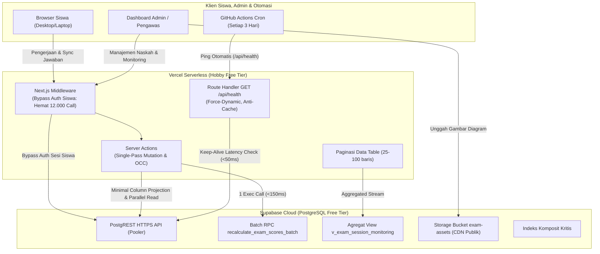

# Platform Ujian Teknis Terpadu (*OSN & General Technical Exam Web*)

[](https://nextjs.org/)
[](https://react.dev/)
[](https://www.typescriptlang.org/)
[](https://supabase.com/)
[](https://tailwindcss.com/)
[](https://vitest.dev/)
[-brightgreen?style=flat)](#arsitektur--kesiapan-free-tier-0bulan)
[](LICENSE)

Platform berbasis web modern dengan performa tinggi untuk penyelenggaraan ujian seleksi olimpiade sains (misal: **OSN Informatika / Komputer**) maupun ujian teknis sekolah dan perguruan tinggi. Dirancang khusus dengan pendekatan arsitektur **Serverless** untuk berjalan andal di infrastruktur **100% Gratis ($0/Bulan)** menggunakan kombinasi **Vercel Hobby Tier**, **Supabase Free Tier (PostgreSQL + Auth + Storage)**, dan **GitHub Actions**.

---

## 📑 Daftar Isi
- [Keunggulan Utama](#-keunggulan-utama)
- [Fitur Aplikasi](#-fitur-aplikasi)
  - [Fitur Peserta Ujian](#1-fitur-peserta-ujian-siswa)
  - [Fitur Pengawas & Administrator](#2-fitur-pengawas--administrator)
- [Arsitektur & Kesiapan Free Tier ($0/Bulan)](#-arsitektur--kesiapan-free-tier-0bulan)
- [Struktur Direktori Proyek](#-struktur-direktori-proyek)
- [Panduan Memulai Cepat (Pengembangan Lokal)](#-panduan-memulai-cepat-pengembangan-lokal)
  - [1. Prasyarat Sistem](#1-prasyarat-sistem)
  - [2. Kloning & Instalasi Dependensi](#2-kloning--instalasi-dependensi)
  - [3. Konfigurasi Variabel Lingkungan](#3-konfigurasi-variabel-lingkungan)
  - [4. Penyiapan Basis Data Supabase](#4-penyiapan-basis-data-supabase)
  - [5. Menjalankan Server Pengembangan](#5-menjalankan-server-pengembangan)
- [Pengujian Otomatis & Analisis Statis](#-pengujian-otomatis--analisis-statis)
- [Panduan Deployment ke Vercel](#-panduan-deployment-ke-vercel)
- [Indeks Dokumentasi Lengkap](#-indeks-dokumentasi-lengkap)
- [Lisensi](#-lisensi)

---

## 🌟 Keunggulan Utama

* ⚡ **100% Serverless & Zero-Cost ($0/bulan):** Seluruh logika mutasi dan kueri telah dioptimalkan untuk mematuhi batas ketat akun gratis Vercel Hobby (timeout 10 detik, 100 GB egress) dan Supabase Free Tier (500 MB database, 50.000 MAU, auto-pause 7 hari).
* 🛡️ **Keamanan Kelas Enterprise (AppSec):**
  * **Anti-Stored XSS:** Integrasi `rehype-sanitize` dengan skema khusus untuk matematika KaTeX dan format tabel GFM.
  * **OWASP Security Headers:** Penerapan `X-Frame-Options: DENY`, `X-Content-Type-Options: nosniff`, `Strict-Transport-Security` (HSTS), dan `Referrer-Policy`.
  * **Pencegah Exploitasi SVG:** Validasi tipe MIME unggahan gambar dibatasi pada raster grafis terkompresi (PNG, JPG, JPEG, WebP maks 2 MB).
  * **Session Security:** Token sesi siswa dienkripsi searah menggunakan hashing kriptografi SHA-256 (`session_token_hash`).
* 🔄 **Ketahanan Koneksi & Sesi (*Dual-Tier Sync*):**
  * Jawaban tersimpan ganda secara instan di memori lokal (*localStorage*) dan tersinkronisasi otomatis ke basis data di latar belakang.
  * Tahan terhadap penyegaran peramban (*browser refresh*), mati listrik, baterai habis, maupun penutupan tab tanpa kehilangan progres pengerjaan (*Browser Session Resumption*).
* ⏱️ **Penghitung Waktu Otoritatif (*Server-Authoritative Timer*):**
  * Sisa waktu ujian dihitung berdasarkan catatan waktu server (`started_at` dan durasi resmi), sehingga manipulasi jam di laptop siswa tidak memengaruhi batas waktu pengerjaan.
  * Penguncian dan penyerahan lembar jawaban otomatis seketika saat waktu habis.
* 🚀 **Performa Sub-Milidetik & Skalabilitas Konkurensi:**
  * **Middleware Auth Bypass:** Mengeliminasi >12.000 panggilan HTTP Auth Supabase per 100 peserta ujian.
  * **Batch Scoring RPC:** Stored procedure massal yang mengevaluasi ratusan peserta dalam waktu **<150 ms** (menghilangkan bahaya 504 Timeout Vercel).
  * **Optimistic Concurrency Control (OCC):** Mencegah *lost update* dan kebocoran kuota kode rujukan saat ratusan peserta menekan tombol mulai ujian serentak (*thundering herd*).
  * **Single-Pass Mutation:** Menggabungkan pembacaan soal, penilaian in-memory, batch upsert jawaban, dan pembaruan status sesi dalam alur terpadu berlatensi ~200 ms.

---

## 🎯 Fitur Aplikasi

### 1. Fitur Peserta Ujian (Siswa)
* **Gerbang Masuk Kode Rujukan:** Validasi kode akses unik dan penentuan kelas/identitas siswa.
* **Lobi Pra-Ujian:** Ringkasan instruksi teknis, jumlah soal, total skor, dan status durasi sebelum menekan tombol "Mulai Kerjakan".
* **Ruang Ujian Interaktif:**
  * **Perender Soal Multi-Format:** Dukungan penuh teks Markdown, formula matematika LaTeX via KaTeX inline (`$...$`) & display (`$$...$$`), serta penyorot sintaks kode multi-bahasa (*syntax highlighting*).
  * **Pratinjau Gambar Lightbox:** Zoom in/out, pan, reset, double-click zoom, dan fullscreen modal untuk gambar bagan/grafik soal.
  * **Tiga Tipe Soal Terpadu:** Pilihan Ganda Tunggal (*Single Choice*), Pilihan Jamak (*Multiple Choice*), dan Isian Singkat (*Short Answer*).
  * **Palet Soal & Sticky Timer:** Navigasi cepat ke nomor soal dengan indikator status (Terjawab, Kosong, Ragu-ragu).
  * **Fitur Ragu-Ragu:** Penandaan warna butir soal untuk ditinjau kembali sebelum waktu berakhir.
  * **Dialog Konfirmasi Penyelesaian:** Rekapitulasi jumlah soal yang belum dijawab atau masih ragu-ragu sebelum menyerahkan ujian.
* **Layar Selesai Ramah:** Kartu ucapan terima kasih personal, rincian skor benar/salah (jika opsi visibilitas nilai diaktifkan oleh pengawas).

### 2. Fitur Pengawas & Administrator
* **Portal Otentikasi Admin Terproteksi:** Autentikasi berbasis Supabase Auth dengan isolasi penuh dari peserta umum.
* **Dasbor Naskah Ujian:** Pembuatan, pengeditan, penerbitan (*publish/draft*), penghapusan naskah, dan opsi kelompok kelas dinamis.
* **Bank Soal & Live Preview:** Editor soal dengan pratinjau markdown instan berdampingan, penentuan bobot poin desimal, kunci jawaban, dan panduan rubrik penilaian.
* **Manajemen Kode Rujukan:** Generator kode rujukan ramah manusia (*human-friendly*, bebas karakter ambigu `0, O, 1, I`), batas kuota penggunaan, dan tanggal kedaluwarsa.
* **Pemantauan Sesi Real-Time (*Active Session Monitoring*):**
  * Tampilan tabel metrik real-time: Total Terdaftar, Sesi Aktif, dan Sesi Selesai.
  * Indikator waktu sinkronisasi terakhir per peserta.
  * **Aksi Terminasi Paksa (*Emergency Force-Submit*):** Tombol bagi pengawas untuk mengunci dan menyelesaikan sesi peserta dari jarak jauh jika terjadi kendala atau pelanggaran.
* **Rekapitulasi Nilai & Laporan Akademis:**
  * Tabel nilai dengan paginasi responsif (10, 25, 50, 100 baris per halaman).
  * Modal dialog rincian lembar jawaban per butir soal siswa.
  * Tombol **"Hitung Ulang Nilai"** berbasis PostgreSQL RPC massal.
  * **Ekspor CSV Lengkap:** Format CSV bertaraf internasional dengan enkoding **UTF-8 BOM** (terbaca rapi tanpa karakter rusak di Microsoft Excel dan Google Sheets).
* **Pengaturan Visibilitas Nilai:** Opsi satu-klik untuk menentukan apakah siswa berhak melihat skor nilai di akhir ujian atau dirahasiakan untuk rapat pleno panitia.

---

## 🏗 Arsitektur & Kesiapan Free Tier ($0/Bulan)

Arsitektur sistem dibangun di atas prinsip pemisahan tugas (*separation of concerns*) yang memaksimalkan efisiensi kuota gratis:



---

## 📁 Struktur Direktori Proyek

```text
osn-general-exam-web/
├── .github/
│   └── workflows/
│       └── keep-alive.yml         # Pemicu cron GitHub Actions pencegah auto-pause Supabase
├── __tests__/                     # Suite pengujian unit dan integrasi (31 berkas, 235 tes)
│   ├── components/                # Pengujian komponen UI & interaksi peserta
│   ├── integration/               # Pengujian end-to-end Server Actions & basis data
│   └── unit/                      # Pengujian mesin skor, token, enkripsi, dan env
├── actions/                       # Next.js Server Actions (logika mutasi server)
│   ├── admin-exams.ts             # Manajemen paket ujian & metadata
│   ├── auth.ts                    # Otentikasi sesi pengawas Supabase
│   ├── exam-report.ts             # Pengambilan data laporan nilai & modal jawaban
│   ├── exam-session.ts            # Registrasi, timer, sinkronisasi, & penyerahan ujian
│   ├── questions.ts               # CRUD butir soal & bank soal
│   ├── referral-codes.ts          # Pembuatan & validasi token rujukan
│   ├── scoring.ts                 # Mesin penilaian otomatis & RPC kalkulasi massal
│   ├── session-monitoring.ts      # Monitoring sesi aktif & terminasi darurat
│   └── storage.ts                 # Unggah gambar diagram soal ke Supabase Storage
├── app/                           # Next.js 15 App Router
│   ├── admin/                     # Area rute terproteksi pengawas (/admin/*)
│   ├── api/
│   │   └── health/route.ts        # Endpoint pemeriksaan kesiapan sistem & keep-alive
│   ├── ujian/                     # Area ruang pengerjaan peserta (/ujian/*)
│   ├── error.tsx                  # Error boundary visual tingkat aplikasi
│   ├── global-error.tsx           # Error boundary visual root layout
│   ├── layout.tsx                 # Layout utama & konfigurasi font
│   └── page.tsx                   # Halaman beranda gerbang masuk kode rujukan
├── components/                    # Komponen React antarmuka pengguna
│   ├── admin/                     # Komponen modul administrasi & laporan
│   └── ui/                        # Komponen desain antarmuka, modal, tabel, & markdown
├── docs/                          # Dokumentasi teknis komprehensif
│   ├── architecture.md            # Desain arsitektur & pola optimasi
│   ├── database-schema.md         # DDL SQL, relasi tabel, indeks, & RPC
│   ├── security.md                # Standar keamanan AppSec & anti-XSS
│   ├── deployment.md              # Panduan deployment Vercel & Supabase
│   └── exam-day-runbook.md        # Panduan panitia pada hari pelaksanaan ujian
├── lib/                           # Modul utilitas & konfigurasi klien
│   ├── exam/                      # Algoritma penskoran & generator CSV UTF-8 BOM
│   ├── security/                  # Hashing token sesi SHA-256
│   ├── supabase/                  # Klien Supabase (client, server, middleware, admin)
│   ├── env.ts                     # Validasi variabel lingkungan fail-fast berbasis Zod
│   └── utils.ts                   # Generator kode ramah manusia & penggabung kelas tailwind
├── supabase/
│   └── migrations/                # Berkas migrasi SQL DDL, RPC, & indeks
├── middleware.ts                  # Edge middleware otentikasi pengawas & bypass siswa
├── next.config.ts                 # Konfigurasi Next.js & injeksi OWASP HTTP Security Headers
├── package.json                   # Dependensi aplikasi & skrip npm
├── tsconfig.json                  # Konfigurasi TypeScript ketat (strict mode)
└── vitest.config.ts               # Konfigurasi runner pengujian Vitest
```

---

## 🚀 Panduan Memulai Cepat (Pengembangan Lokal)

Ikuti langkah-langkah berikut untuk menjalankan aplikasi di komputer lokal Anda:

### 1. Prasyarat Sistem
* [Node.js](https://nodejs.org/) versi `18.18.0` atau `20.x` (disarankan).
* Manajer paket `npm` (bawaan Node.js).
* Akun gratis [Supabase](https://supabase.com/) untuk basis data cloud lokal.

### 2. Kloning & Instalasi Dependensi
```bash
# Kloning repositori
git clone https://github.com/username/osn-general-exam-web.git

# Masuk ke direktori proyek
cd osn-general-exam-web

# Pasang seluruh dependensi proyek
npm install
```

### 3. Konfigurasi Variabel Lingkungan
Salin berkas template lingkungan atau buat berkas baru bernama `.env.local` pada akar proyek:
```bash
cp .env.example .env.local
```

Isi berkas `.env.local` dengan kredensial proyek Supabase Anda:
```env
# Kredensial Proyek Supabase (Dapat diperoleh dari Dasbor Supabase -> Project Settings -> API)
NEXT_PUBLIC_SUPABASE_URL=https://xxxxxxxxxxxxxxxxxxxx.supabase.co
NEXT_PUBLIC_SUPABASE_ANON_KEY=eyJhbGciOiJIUzI1NiIsInR5cCI6IkpXVCJ9...
SUPABASE_SERVICE_ROLE_KEY=eyJhbGciOiJIUzI1NiIsInR5cCI6IkpXVCJ9...
NODE_ENV=development
```

### 4. Penyiapan Basis Data Supabase
1. Masuk ke [Supabase Dashboard](https://supabase.com/dashboard) $\to$ buka menu **SQL Editor**.
2. Jalankan skrip DDL skema tabel utama dan skrip optimasi kueri (tersedia pada dokumentasi [docs/database-schema.md](docs/database-schema.md)).
3. Masuk ke menu **Storage** $\to$ buat bucket baru bernama **`exam-assets`** dengan opsi **Public Bucket = ON** dan batas ukuran 2 MB.
4. Masuk ke menu **Authentication $\to$ Users** $\to$ buat satu akun pengawas pertama Anda.

### 5. Menjalankan Server Pengembangan
```bash
npm run dev
```
Buka peramban di [http://localhost:3000](http://localhost:3000):
* Halaman Peserta Ujian: `http://localhost:3000/`
* Portal Masuk Pengawas: `http://localhost:3000/admin/masuk`
* Endpoint Status Kesehatan: `http://localhost:3000/api/health`

---

## 🧪 Pengujian Otomatis & Analisis Statis

Aplikasi dilengkapi dengan rangkaian pengujian otomatis end-to-end yang menjamin kestabilan seluruh alur sistem:

```powershell
# Menjalankan seluruh 31 berkas pengujian (235 tests) via Vitest
npm test

# Menjalankan pengujian dalam mode pantau aktif (watch mode)
npm run test:watch

# Memverifikasi validitas tipe data TypeScript (zero-error check)
npm run typecheck

# Memverifikasi konvensi kode & linting ESLint
npm run lint
```

---

## 🌐 Panduan Deployment ke Vercel

Deployment ke lingkungan produksi Vercel Free Tier ($0) dapat diselesaikan dalam waktu kurang dari 5 menit:

1. Buka [Vercel Dashboard](https://vercel.com) $\to$ klik **Add New... $\to$ Project** $\to$ pilih repositori ini.
2. Masukkan 3 kunci variabel lingkungan pada panel Vercel:
   * `NEXT_PUBLIC_SUPABASE_URL`
   * `NEXT_PUBLIC_SUPABASE_ANON_KEY`
   * `SUPABASE_SERVICE_ROLE_KEY`
3. Klik tombol **Deploy**.
4. Buka repositori GitHub Anda $\to$ **Settings $\to$ Secrets and variables $\to$ Actions** $\to$ tambahkan secret `PRODUCTION_APP_URL` dengan nilai URL domain Vercel Anda agar workflow keep-alive berjalan otomatis setiap 3 hari.

> 📖 **Panduan Langkah Demi Langkah Lengkap:** Silakan baca panduan lengkap pada [docs/deployment.md](docs/deployment.md).

---

## 📚 Indeks Dokumentasi Lengkap

Untuk panduan operasional dan arsitektur teknis yang lebih mendalam, silakan telaah berkas dokumentasi resmi berikut:

* 📐 [**docs/architecture.md**](docs/architecture.md): Prinsip desain sistem, efisiensi Serverless, konsolidasi mutasi *Single-Pass*, dan kontrol konkurensi OCC.
* 🗄️ [**docs/database-schema.md**](docs/database-schema.md): Skema relasi PostgreSQL, skrip DDL lengkap, fungsi Stored Procedure batch RPC, agregat view, dan Row Level Security (RLS).
* 🔒 [**docs/security.md**](docs/security.md): Standar keamanan AppSec, mitigasi Stored XSS KaTeX, pengerasan Supabase Auth, dan injeksi OWASP HTTP Headers.
* 🚀 [**docs/deployment.md**](docs/deployment.md): Panduan lengkap deployment produksi ke Vercel Hobby dan Supabase Free Tier tanpa biaya.
* 📋 [**docs/exam-day-runbook.md**](docs/exam-day-runbook.md): Prosedur operasional panitia/proktor pada hari pelaksanaan ujian (T-60 menit, saat ujian, terminasi darurat, dan ekspor rekapitulasi).

---

## 📄 Lisensi

Proyek ini dirilis di bawah lisensi terbuka [MIT License](LICENSE). Bebas digunakan, dimodifikasi, dan didistribusikan untuk keperluan pendidikan maupun institusi akademis.

