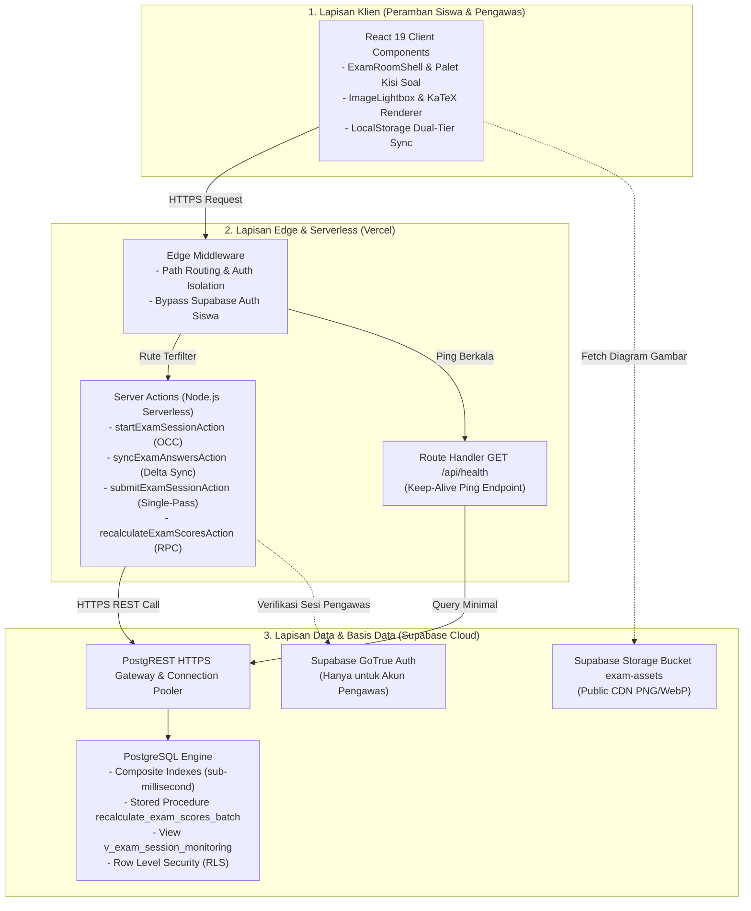

# Desain Arsitektur & Optimasi Sistem
## Platform Ujian Teknis Terpadu (*OSN & General Technical Exam Web*)

Dokumen ini menjelaskan arsitektur teknis, pola desain (*design patterns*), mekanisme keandalan koneksi, dan strategi optimasi konkurensi pada aplikasi `osn-general-exam-web`.

---

## 1. Filosofi Arsitektur & Prinsip Desain

Platform ini dirancang dengan prinsip dasar:
1. **Server-Authoritative, Client-Responsive:** Seluruh validasi integritas (waktu pengerjaan, kuota kode rujukan, perhitungan nilai, dan hak akses data) dikendalikan sepenuhnya oleh server. Klien bertanggung jawab menyajikan antarmuka yang cepat (*zero-latency feedback*), memproses interaksi kaya (KaTeX, syntax highlight, lightbox), dan menjaga salinan lokal progres ujian.
2. **Zero Infrastructure Cost ($0 Free Tier):** Mengeliminasi kebutuhan server VPS atau database berbayar dengan memanfaatkan batas gratis Vercel Hobby dan Supabase Free Tier secara cerdas.
3. **Resilience over Reliability:** Mengasumsikan bahwa koneksi internet di sekolah atau tempat ujian dapat terputus sewaktu-waktu. Oleh karena itu, aplikasi harus tetap berjalan normal saat *offline* parsial dan dapat memulihkan diri secara mulus saat koneksi pulih (*graceful recovery*).

---

## 2. Topologi Tiga Tingkat (*Three-Tier Serverless Architecture*)

---

## 3. Mekanisme Keandalan Koneksi (*Fault-Tolerance Mechanisms*)

### A. Sinkronisasi Dua Tingkat (*Dual-Tier Answer Sync*)
Untuk melindungi siswa dari kegagalan transmisi jaringan saat menjawab soal:
1. **Tier 1 (Memori Lokal Klien):** Setiap kali siswa mengklik opsi jawaban atau mengetik isian singkat, state langsung diperbarui di memori aplikasi dan ditulis ke `localStorage` peramban. Aksi ini berlangsung instan (<5 ms) tanpa menunggu respon jaringan.
2. **Tier 2 (Basis Data Serverless):** Hook latar belakang (`useExamSync`) mengantrekan perubahan jawaban dan mengirimkan *payload delta* secara terkelompok (*batched background sync*) ke server setiap beberapa detik atau saat berpindah nomor soal. Jika pengiriman gagal akibat jaringan putus, status ditandai kuning/merah tanpa mengganggu navigasi siswa, dan akan dicoba kembali secara otomatis saat jaringan tersambung.

### B. Pemulihan Sesi Peramban (*Browser Session Resumption*)
Jika laptop siswa mati, kehabisan baterai, atau jendela peramban tertutup:
1. Sesi pengerjaan diikat pada cookie terproteksi `exam_token` (berisi token acak aman yang di-hash SHA-256 di basis data).
2. Saat peramban dibuka kembali dan mengakses `/`, middleware dan Server Component mendeteksi sesi yang belum selesai (`is_completed = false`).
3. Pengguna disajikan kartu interaktif **"Lanjutkan Sesi Ujian"** yang mengembalikan siswa langsung ke nomor soal terakhir beserta seluruh jawaban yang telah tersimpan di server.
4. Sisa waktu pengerjaan tetap sinkron dengan jam server tanpa kehilangan waktu resmi.

### C. Timer Otoritatif Server (*Server-Authoritative Timer*)
* Sisa durasi ujian **TIDAK PERNAH** dipercayakan pada jam lokal peramban siswa.
* Saat siswa mulai ujian, server mencatat timestamp resmi `started_at`.
* Rumus sisa waktu:
  $$\text{Sisa Waktu} = \min\left((\text{started\_at} + \text{durasi}) - \text{Waktu Server Sekarang},\, \text{ends\_at} - \text{Waktu Server Sekarang}\right)$$
* Komponen `ExamTimer` melakukan sinkronisasi delta dengan server saat inisialisasi, dan secara otomatis memicu penguncian input serta modal penyerahan darurat begitu waktu menyentuh angka nol.

---

## 4. Tujuh Pilar Optimasi Kueri & Concurrency Control

Berikut adalah ringkasan strategi rekayasa yang membuat sistem ini mampu melayani ratusan peserta serentak pada tier gratis:

### 1. Middleware Supabase Auth Bypass (Jalur Siswa)
* **Masalah:** Supabase Free Tier memiliki batas kuota 50.000 Monthly Active Users (MAU). Setiap pemanggilan `updateSession()` pada Next.js middleware melakukan verifikasi JWT ke server GoTrue Auth. Jika 100 siswa melakukan refresh atau navigasi, ribuan panggilan Auth API akan cepat menghabiskan kuota gratis.
* **Solusi:** [`middleware.ts`](file:///d:/MyProject/osn-general-exam-web/middleware.ts) memeriksa awalan URL (`pathname`). Jalur peserta (`/` dan `/ujian/*`) diverifikasi murni berbasis keberadaan cookie `exam_token` tanpa memanggil Auth Supabase. Pemanggilan Supabase Auth diisolasi secara eksklusif untuk jalur pengawas (`/admin/*`).
* **Dampak:** Menghemat **>12.000 panggilan HTTP Auth** per sesi ujian 90 menit.

### 2. Batch Scoring RPC (`recalculate_exam_scores_batch`)
* **Masalah:** Pada kalkulasi ulang skor ujian (misal: saat kunci jawaban direvisi), pendekatan konvensional melakukan iterasi $N$ sesi dan $M$ soal, menimbulkan masalah kueri $N+1$ (501 kueri sekuensial) yang memakan waktu ~25 detik, memicu fatal **504 Gateway Timeout** di Vercel Hobby (batas 10 detik).
* **Solusi:** Seluruh logika evaluasi dipindahkan ke satu Stored Procedure PostgreSQL `recalculate_exam_scores_batch(target_exam_id)` yang mengevaluasi pilihan ganda, pilihan jamak, dan menjumlahkan total nilai secara atomik di dalam basis data.
* **Dampak:** Waktu kalkulasi turun dari 25 detik menjadi **<150 milidetik** (1 kueri tunggal).

### 3. Konsolidasi Penyerahan Ujian (*Single-Pass Submit & Score*)
* **Masalah:** Saat siswa menekan "Kumpulkan Ujian", alur lama menjalankan 8 roundtrip terpisah: pembacaan sesi, pembacaan soal, pembacaan jawaban tersimpan, upsert jawaban, update sesi, panggil fungsi skoring terpisah, baca ulang skor, dan update total skor.
* **Solusi:** [`actions/exam-session.ts`](file:///d:/MyProject/osn-general-exam-web/actions/exam-session.ts) memuat soal dan jawaban secara paralel via `Promise.all`, menghitung perolehan skor murni di memori Server Action menggunakan fungsi murni `calculateExamSessionScores`, menyimpan lembar jawaban lengkap dengan `awarded_score` dalam 1 kali batch upsert, dan mengunci sesi (`is_completed = true`, `submitted_at`, `total_score`) dalam 1 kali mutasi update.
* **Dampak:** Memangkas 8 database roundtrip menjadi 2 paralel read + 2 batch write (latensi ~200 ms).

### 4. Minimal Column Projection pada Denyut Sinkronisasi
* **Masalah:** Pemanggilan denyut nadi (*heartbeat*) setiap 30 detik untuk memeriksa validitas sesi sebelumnya menggunakan `select('*, exams(*)')`, yang mentransfer teks panjang deskripsi soal dan metadata yang tidak berubah.
* **Solusi:** Dipersempit hanya pada kolom esensial: `'id, exam_id, student_name, student_class, session_token_hash, is_completed, started_at, submitted_at, exams(id, title, duration_minutes, ends_at)'`.
* **Dampak:** Menghemat ~70% volume payload JSON pada jaringan.

### 5. Optimistic Concurrency Control (OCC) pada Kuota Kode Rujukan
* **Masalah:** Saat ratusan siswa menekan "Mulai Kerjakan Ujian" pada detik yang sama (*thundering herd*), pembacaan dan penambahan kuota rentan mengalami *race condition* / *lost update*, sehingga kuota penggunaan kode jebol melebihi batas.
* **Solusi:** [`startExamSessionAction`](file:///d:/MyProject/osn-general-exam-web/actions/exam-session.ts) menerapkan OCC melalui filter kondisional atomik `.eq('current_uses', currentUsesVal)`. Jika terjadi perubahan simultan oleh peserta lain, mutasi ditolak dan sistem mencoba kembali (*retry loop*) hingga 3 kali. Jika kuota terbukti habis, sesi yatim dibersihkan seketika.
* **Dampak:** Bebas dari kelebihan kuota tanpa memerlukan *table locking* yang membebani CPU database.

### 6. Paginasi Tabel Administrasi
* **Masalah:** Menampilkan ratusan baris peserta ujian secara utuh pada layar laporan nilai dan pemantauan sesi membebani memori peramban (*DOM Bloat*).
* **Solusi:** Komponen reusable [`components/admin/data-table-pagination.tsx`](file:///d:/MyProject/osn-general-exam-web/components/admin/data-table-pagination.tsx) menyajikan data dalam pecahan 10, 25, 50, atau 100 baris per halaman, dengan penomoran urut otomatis berlanjut dan tetap mempertahankan integritas ekspor CSV yang mencakup seluruh data (*unpaginated*).
* **Dampak:** Konsumsi memori peramban pengawas tetap stabil di bawah 50 MB.

### 7. Pola Singleton pada Supabase Service Client
* **Masalah:** Instansiasi klien baru pada setiap eksekusi Server Action di lingkungan serverless membuang alokasi memori dan tidak memanfaatkan *HTTP connection reuse*.
* **Solusi:** [`lib/supabase/admin.ts`](file:///d:/MyProject/osn-general-exam-web/lib/supabase/admin.ts) menyimpan instans klien pada variabel tingkat modul (`cachedServiceClient`) yang di-*reuse* antar pemanggilan pada kontainer Vercel yang hangat (*warm instance*).

