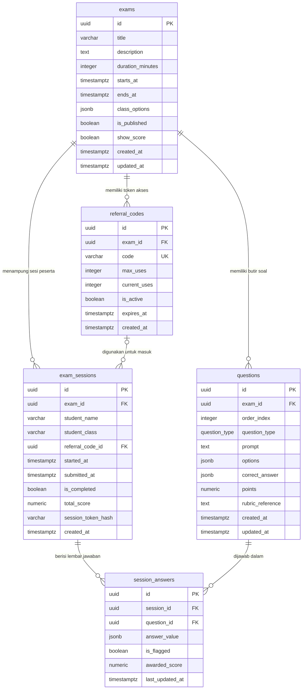

# Skema Basis Data & Desain Relasional
## Platform Ujian Teknis Terpadu (*OSN & General Technical Exam Web*)

Dokumen ini merinci rancangan skema basis data PostgreSQL pada Supabase, mencakup diagram entitas relasional (ERD), definisi data (DDL), indeks performa, fungsi *Stored Procedure* (RPC), view agregat, serta kebijakan keamanan tingkat baris (*Row Level Security*).

---

## 1. Diagram Relasi Entitas (ERD)



---

## 2. Kamus Data & Definisi Tabel

### 1. Tabel `exams` (Naskah & Paket Ujian)
Menyimpan metadata paket ujian, rentang waktu akses, opsi kelas, dan pengaturan visibilitas nilai.

| Nama Kolom | Tipe Data | Keterangan |
| :--- | :--- | :--- |
| `id` | `UUID` (PK) | Identifier unik paket ujian (`uuid_generate_v4()`). |
| `title` | `VARCHAR(255)` | Judul paket ujian (misal: "Simulasi OSN Informatika 2026"). |
| `description` | `TEXT` | Petunjuk teknis pengerjaan ujian dalam format Markdown. |
| `duration_minutes` | `INTEGER` | Alokasi durasi resmi pengerjaan (harus > 0). |
| `starts_at` | `TIMESTAMPTZ` | Waktu gerbang ujian mulai dibuka untuk akses masuk. |
| `ends_at` | `TIMESTAMPTZ` | Batas akhir mutlak penyerahan lembar jawaban (`ends_at > starts_at`). |
| `class_options` | `JSONB` | Daftar nama kelas yang diizinkan, format array string `["X-A", "X-B"]`. |
| `is_published` | `BOOLEAN` | Status publikasi. `false` = draf (tidak bisa diakses siswa), `true` = aktif. |
| `show_score` | `BOOLEAN` | Apakah skor total dan rincian benar/salah ditampilkan ke siswa setelah selesai. Default: `false`. |
| `created_at` | `TIMESTAMPTZ` | Timestamp pembuatan paket ujian. |
| `updated_at` | `TIMESTAMPTZ` | Timestamp pembaruan terakhir. |

---

### 2. Tabel `questions` (Bank Butir Soal Ujian)
Menyimpan butir-butir pertanyaan naskah ujian beserta kunci jawaban dan panduan rubrik.

| Nama Kolom | Tipe Data | Keterangan |
| :--- | :--- | :--- |
| `id` | `UUID` (PK) | Identifier unik butir soal. |
| `exam_id` | `UUID` (FK) | Relasi ke `exams(id)` dengan `ON DELETE CASCADE`. |
| `order_index` | `INTEGER` | Nomor urut soal dalam ujian (indeks mulai dari 0 atau 1). Unik per paket ujian. |
| `question_type` | `ENUM` | Tipe soal: `'single_choice'`, `'multiple_choice'`, atau `'short_answer'`. |
| `prompt` | `TEXT` | Stimulus dan narasi soal berformat Markdown, LaTeX KaTeX, dan tag gambar. |
| `options` | `JSONB` | Array opsi pilihan untuk PG/Jamak, format: `[{"id":"A","label":"..."}, ...]`. |
| `correct_answer` | `JSONB` | Kunci jawaban resmi. PG: `{"selected":"A"}`; Jamak: `{"selected":["A","C"]}`; Isian: `{"text":"jawaban"}`. |
| `points` | `NUMERIC(6,2)` | Bobot nilai maksimal butir soal (misal: `10.00`). |
| `rubric_reference` | `TEXT` | Panduan rubrik evaluasi atau kunci alternatif bagi pengawas. |
| `created_at` | `TIMESTAMPTZ` | Timestamp pembuatan butir soal. |
| `updated_at` | `TIMESTAMPTZ` | Timestamp perubahan terakhir. |

---

### 3. Tabel `referral_codes` (Token Akses Masuk Siswa)
Mengatur gerbang otorisasi masuk siswa tanpa memerlukan akun/email tersendiri.

| Nama Kolom | Tipe Data | Keterangan |
| :--- | :--- | :--- |
| `id` | `UUID` (PK) | Identifier unik kode rujukan. |
| `exam_id` | `UUID` (FK) | Relasi ke naskah ujian yang dituju. |
| `code` | `VARCHAR(64)` | Kode unik alfanumerik ramah manusia (misal: `OSN26-MATH`, huruf kapital tanpa 0/O/1/I). |
| `max_uses` | `INTEGER` | Batas maksimal jumlah siswa yang dapat menggunakan kode ini. |
| `current_uses` | `INTEGER` | Jumlah penggunaan yang telah berhasil diverifikasi. |
| `is_active` | `BOOLEAN` | Saklar aktifasi kode rujukan oleh pengawas. |
| `expires_at` | `TIMESTAMPTZ` | Batas kedaluwarsa kode rujukan (opsional). |
| `created_at` | `TIMESTAMPTZ` | Timestamp penerbitan kode. |

---

### 4. Tabel `exam_sessions` (Sesi Pengerjaan Peserta)
Merekam identitas peserta, waktu mulai pengerjaan resmi, dan status penyelesaian.

| Nama Kolom | Tipe Data | Keterangan |
| :--- | :--- | :--- |
| `id` | `UUID` (PK) | Identifier unik sesi pengerjaan siswa. |
| `exam_id` | `UUID` (FK) | Relasi ke paket ujian yang sedang dikerjakan. |
| `student_name` | `VARCHAR(255)` | Nama lengkap peserta ujian. |
| `student_class` | `VARCHAR(100)` | Kelas peserta ujian (dipilih dari `exams.class_options`). |
| `referral_code_id` | `UUID` (FK) | Kode rujukan yang digunakan untuk memulai sesi. |
| `started_at` | `TIMESTAMPTZ` | Waktu server saat tombol "Mulai Kerjakan" ditekan (patokan timer resmi). |
| `submitted_at` | `TIMESTAMPTZ` | Waktu penyerahan lembar jawaban (manual atau auto-lock timer). |
| `is_completed` | `BOOLEAN` | Status penyelesaian. `true` = terkunci permanen. |
| `total_score` | `NUMERIC(6,2)` | Akumulasi nilai akhir yang diperoleh peserta. |
| `session_token_hash`| `VARCHAR(64)` | Nilai hash SHA-256 dari cookie `exam_token` peramban siswa. |
| `created_at` | `TIMESTAMPTZ` | Timestamp inisialisasi sesi. |

---

### 5. Tabel `session_answers` (Lembar Jawaban Siswa)
Merekam butir jawaban yang diisi peserta beserta status ragu-ragu dan perolehan nilai.

| Nama Kolom | Tipe Data | Keterangan |
| :--- | :--- | :--- |
| `id` | `UUID` (PK) | Identifier unik baris jawaban. |
| `session_id` | `UUID` (FK) | Relasi ke `exam_sessions(id)`. |
| `question_id` | `UUID` (FK) | Relasi ke `questions(id)`. |
| `answer_value` | `JSONB` | Pilihan atau teks jawaban siswa. PG: `{"selected":"A"}`; Jamak: `{"selected":["A","B"]}`; Isian: `{"text":"..."}`. |
| `is_flagged` | `BOOLEAN` | Penanda tombol ragu-ragu peserta. |
| `awarded_score` | `NUMERIC(6,2)` | Skor yang diperoleh pada butir ini (terisi otomatis atau manual). |
| `last_updated_at` | `TIMESTAMPTZ` | Timestamp terakhir siswa mengubah jawaban pada butir ini. |

---

## 3. Indeks Majemuk Kritis (*Composite Indexes*)

Empat indeks komposit dipasang untuk memastikan kueri selesai dalam waktu <1 ms pada volume ratusan ribu baris:

```sql
-- 1. Mengoptimalkan sinkronisasi latar belakang jawaban per sesi terurut waktu
CREATE INDEX IF NOT EXISTS idx_session_answers_session_updated 
ON public.session_answers(session_id, last_updated_at DESC);

-- 2. Mengoptimalkan penyaringan butir soal berdasarkan tipe pada evaluasi manual
CREATE INDEX IF NOT EXISTS idx_questions_exam_type 
ON public.questions(exam_id, question_type);

-- 3. Mengoptimalkan pencarian sesi ujian selesai untuk laporan dan rekapitulasi nilai
CREATE INDEX IF NOT EXISTS idx_exam_sessions_exam_completed 
ON public.exam_sessions(exam_id, is_completed);

-- 4. Mengoptimalkan verifikasi instan kode rujukan aktif di gerbang masuk
CREATE INDEX IF NOT EXISTS idx_referral_codes_active_lookup 
ON public.referral_codes(code, is_active);
```

---

## 4. Stored Procedure / Batch RPC: `recalculate_exam_scores_batch`

Fungsi PostgreSQL ini mengeliminasi masalah kueri $N+1$, mengevaluasi seluruh lembar jawaban ujian yang telah selesai secara massal dan atomik:

```sql
CREATE OR REPLACE FUNCTION public.recalculate_exam_scores_batch(target_exam_id UUID)
RETURNS TABLE (processed_sessions INTEGER) AS $$
DECLARE
    session_count INTEGER;
BEGIN
    -- Evaluasi & simpan awarded_score secara atomik untuk seluruh sesi yang telah selesai
    UPDATE public.session_answers sa
    SET 
        awarded_score = CASE 
            -- Pilihan Ganda (single_choice): bandingkan string selected
            WHEN q.question_type = 'single_choice' THEN 
                CASE WHEN (sa.answer_value->>'selected') = (q.correct_answer->>'selected') 
                     THEN q.points ELSE 0 END
            -- Pilihan Jamak (multiple_choice): bandingkan kesetaraan array JSON
            WHEN q.question_type = 'multiple_choice' THEN 
                CASE WHEN (sa.answer_value->'selected') = (q.correct_answer->'selected') 
                     THEN q.points ELSE 0 END
            -- Isian Singkat: pertahankan nilai manual yang sudah diberikan, atau default 0
            ELSE COALESCE(sa.awarded_score, 0)
        END,
        last_updated_at = now()
    FROM public.questions q, public.exam_sessions es
    WHERE sa.question_id = q.id 
      AND sa.session_id = es.id 
      AND es.exam_id = target_exam_id
      AND es.is_completed = true;

    -- Akumulasikan total_score untuk masing-masing exam_sessions
    WITH session_totals AS (
        SELECT 
            sa.session_id,
            ROUND(COALESCE(SUM(sa.awarded_score), 0), 2) AS calculated_score
        FROM public.session_answers sa
        JOIN public.exam_sessions es ON es.id = sa.session_id
        WHERE es.exam_id = target_exam_id
          AND es.is_completed = true
        GROUP BY sa.session_id
    )
    UPDATE public.exam_sessions es
    SET total_score = st.calculated_score
    FROM session_totals st
    WHERE es.id = st.session_id;

    GET DIAGNOSTICS session_count = ROW_COUNT;
    RETURN QUERY SELECT session_count;
END;
$$ LANGUAGE plpgsql SECURITY DEFINER;
```

---

## 5. View Agregat: `v_exam_session_monitoring`

Mengagregasi metrik pengerjaan peserta langsung di mesin PostgreSQL, memangkas 97.5% transmisi bandwidth egress:

```sql
CREATE OR REPLACE VIEW public.v_exam_session_monitoring AS
SELECT 
    es.id AS session_id,
    es.exam_id,
    es.student_name,
    es.student_class,
    es.started_at,
    es.submitted_at,
    es.is_completed,
    es.total_score,
    COUNT(sa.id) AS answered_count,
    MAX(sa.last_updated_at) AS last_sync_at
FROM public.exam_sessions es
LEFT JOIN public.session_answers sa ON sa.session_id = es.id 
    AND sa.answer_value IS NOT NULL
GROUP BY es.id;
```

---

## 6. Kebijakan Keamanan Tingkat Baris (*Row Level Security*)

Seluruh tabel publik dilindungi oleh RLS untuk memastikan data tidak dapat dimanipulasi secara langsung:

```sql
ALTER TABLE public.exams ENABLE ROW LEVEL SECURITY;
ALTER TABLE public.questions ENABLE ROW LEVEL SECURITY;
ALTER TABLE public.referral_codes ENABLE ROW LEVEL SECURITY;
ALTER TABLE public.exam_sessions ENABLE ROW LEVEL SECURITY;
ALTER TABLE public.session_answers ENABLE ROW LEVEL SECURITY;

-- Hak Akses Penuh untuk Pengawas / Administrator Terotentikasi
CREATE POLICY "Admin CRUD Exams" ON public.exams
    FOR ALL TO authenticated USING (true) WITH CHECK (true);

CREATE POLICY "Admin CRUD Questions" ON public.questions
    FOR ALL TO authenticated USING (true) WITH CHECK (true);

CREATE POLICY "Admin CRUD ReferralCodes" ON public.referral_codes
    FOR ALL TO authenticated USING (true) WITH CHECK (true);

CREATE POLICY "Admin CRUD ExamSessions" ON public.exam_sessions
    FOR ALL TO authenticated USING (true) WITH CHECK (true);

CREATE POLICY "Admin CRUD SessionAnswers" ON public.session_answers
    FOR ALL TO authenticated USING (true) WITH CHECK (true);
```

