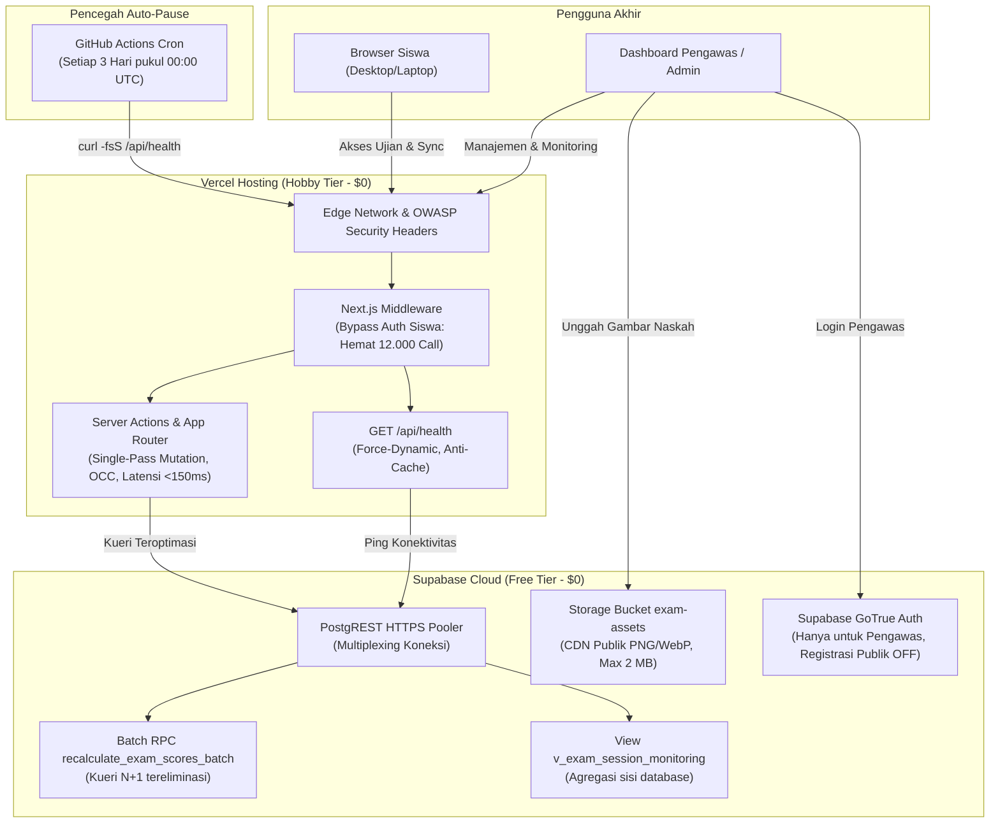

# Panduan Lengkap Deployment Produksi
## Platform Ujian Teknis Terpadu (*OSN & General Technical Exam Web*)
### Target Lingkungan: Vercel Hosting (Hobby Tier) + Supabase (Free Tier) ($0/Bulan)

Dokumen ini merupakan panduan operasional definitif dan langkah demi langkah (*step-by-step master runbook*) untuk meluncurkan aplikasi **`osn-general-exam-web`** ke lingkungan produksi publik tanpa biaya infrastruktur bulanan (**100% Free Tier**), memanfaatkan kombinasi **Vercel Hobby Tier**, **Supabase Free Tier (PostgreSQL + Auth + Storage)**, dan **GitHub Actions (Keep-Alive Automation)**.

---

## Daftar Isi
1. [Ringkasan Arsitektur & Spesifikasi Free Tier](#1-ringkasan-arsitektur--spesifikasi-free-tier)
2. [Pra-Syarat & Alat yang Dibutuhkan](#2-pra-syarat--alat-yang-dibutuhkan)
3. [Fase 1: Konfigurasi Basis Data, Keamanan, & Storage Supabase](#3-fase-1-konfigurasi-basis-data-keamanan--storage-supabase)
   - [3.1 Membuat Proyek Supabase](#31-membuat-proyek-supabase)
   - [3.2 Menjalankan Skrip Skema DDL & Migrasi SQL](#32-menjalankan-skrip-skema-ddl--migrasi-sql)
   - [3.3 Menyiapkan Storage Bucket Diagram Soal (`exam-assets`)](#33-menyiapkan-storage-bucket-diagram-soal-exam-assets)
   - [3.4 Pengerasan Keamanan Supabase Auth (Pendaftaran Tertutup)](#34-pengerasan-keamanan-supabase-auth-pendaftaran-tertutup)
   - [3.5 Mengambil Kredensial Kunci API Supabase](#35-mengambil-kredensial-kunci-api-supabase)
4. [Fase 2: Deployment ke Vercel (Hobby Tier)](#4-fase-2-deployment-ke-vercel-hobby-tier)
   - [4.1 Menghubungkan Repositori GitHub ke Vercel](#41-menghubungkan-repositori-github-ke-vercel)
   - [4.2 Konfigurasi Proyek & Build Settings](#42-konfigurasi-proyek--build-settings)
   - [4.3 Mengisi Variabel Lingkungan (Environment Variables)](#43-mengisi-variabel-lingkungan-environment-variables)
   - [4.4 Menjalankan Build & Memperoleh Domain Produksi](#44-menjalankan-build--memperoleh-domain-produksi)
5. [Fase 3: Konfigurasi Otomasi Pencegah Auto-Pause Supabase (Keep-Alive)](#5-fase-3-konfigurasi-otomasi-pencegah-auto-pause-supabase-keep-alive)
   - [5.1 Opsi Utama: GitHub Actions Workflow (Otomatis & Terintegrasi)](#51-opsi-utama-github-actions-workflow-otomatis--terintegrasi)
   - [5.2 Opsi Alternatif: Cron-Job.org (Zero-Code Eksternal)](#52-opsi-alternatif-cron-joborg-zero-code-eksternal)
6. [Fase 4: Verifikasi Pasca-Deployment (Smoke Testing Checklist)](#6-fase-4-verifikasi-pasca-deployment-smoke-testing-checklist)
7. [Fase 5: Panduan Operasional Hari Pelaksanaan Ujian (*Exam Day Runbook*)](#7-fase-5-panduan-operasional-hari-pelaksanaan-ujian-exam-day-runbook)
8. [Panduan Pemecahan Masalah (Troubleshooting & FAQ)](#8-panduan-pemecahan-masalah-troubleshooting--faq)

---

## 1. Ringkasan Arsitektur & Spesifikasi Free Tier

Aplikasi telah dioptimalkan secara arsitektural untuk beroperasi dengan performa tinggi pada batasan ketat akun gratis:



### Matriks Batasan Layanan Free Tier:

| Komponen Layanan | Batasan Free Tier | Konsumsi Aplikasi Kita | Status Kepatuhan |
| :--- | :--- | :--- | :---: |
| **Vercel: Serverless Timeout** | Maksimal **10 detik** per eksekusi | Rata-rata Server Action selesai dalam **<150 ms** | ✅ **Sangat Aman** (<2% batas) |
| **Vercel: Edge Bandwidth** | 100 GB / bulan | Naskah soal di-cache per sesi; sync berkala hanya mentransfer JSON delta (~1–2 KB) | ✅ **Sangat Aman** (<3 GB / event) |
| **Vercel: Image Optimization** | 1.000 transformasi gambar / bulan | Gambar diagram diakses langsung dari CDN publik Supabase Storage (0 kredit Vercel terpakai) | ✅ **Sangat Aman** (0 kredit terpakai) |
| **Supabase: Database Storage** | 500 MB | Seluruh basis data berupa teks terkompresi & referensi UUID | ✅ **Sangat Aman** (Estimasi <25 MB) |
| **Supabase: Storage Capacity** | 1 GB gratis | Diagram teknis PNG/WebP berukuran rata-rata 100–300 KB | ✅ **Sangat Aman** |
| **Supabase: Egress Bandwidth** | 5 GB / bulan | Minimal column projection + View agregat memangkas volume PostgREST >90% | ✅ **Sangat Aman** (<1 GB / 100 peserta) |
| **Supabase: Monthly Active Users** | 50.000 MAU gratis | Middleware Auth Bypass memastikan siswa tidak menyentuh endpoint Auth; hanya pengawas yang tercatat sebagai MAU | ✅ **Sangat Aman** (1–5 MAU) |
| **Supabase: Inactivity Auto-Pause** | Berhenti otomatis jika hening **7 hari** | Workflow GitHub Actions melakukan ping ke `/api/health` setiap **3 hari sekali** | ✅ **Sangat Aman** (Database selalu aktif) |

---

## 2. Pra-Syarat & Alat yang Dibutuhkan

Sebelum memulai proses deployment, pastikan Anda telah memiliki:

1. **Akun GitHub:** Digunakan untuk menyimpan kode sumber dan menjalankan GitHub Actions cron keep-alive.
2. **Akun Vercel:** Terhubung dengan akun GitHub Anda ([https://vercel.com](https://vercel.com)).
3. **Akun Supabase:** ([https://supabase.com](https://supabase.com)).
4. **Git CLI & Node.js 18+ / 20+** pada komputer lokal Anda.
5. **Kesiapan Repositori Lokal:**
   Pastikan seluruh perubahan kode telah ter-commit dan pengujian lokal lulus 100%:
   ```powershell
   # 1. Jalankan pengujian unit & integrasi
   npm test
   # Pastikan: 31 berkas pengujian, 235 tes lolos 100%

   # 2. Jalankan pemeriksaan tipe TypeScript
   npx tsc --noEmit
   # Pastikan: 0 error

   # 3. Jalankan linter
   npm run lint
   # Pastikan: 0 error

   # 4. Pastikan status git bersih
   git status
   ```

---

## 3. Fase 1: Konfigurasi Basis Data, Keamanan, & Storage Supabase

### 3.1 Membuat Proyek Supabase
1. Masuk ke [Supabase Dashboard](https://supabase.com/dashboard).
2. Klik tombol **"New project"**.
3. Isi parameter proyek:
   * **Name:** `osn-general-exam-web` (atau nama institusi Anda).
   * **Database Password:** Buat kata sandi acak yang kuat (misal: 16+ karakter kombinasi) dan catat di tempat aman.
   * **Region:** Pilih **Singapore (`ap-southeast-1`)** untuk latensi terendah bagi pengguna di Indonesia.
   * **Pricing Plan:** Pilih **Free Tier ($0/month)**.
4. Klik **"Create new project"** dan tunggu 1–2 menit hingga penyediaan basis data selesai.

---

### 3.2 Menjalankan Skrip Skema DDL & Migrasi SQL
Buka menu **SQL Editor** pada bilah sisi kiri dashboard Supabase, lalu jalankan dua skrip berikut secara berurutan:

#### Skrip 1: Skema Utama & Relasi Tabel DDL
Klik tombol **"New query"**, beri nama *`01_initial_schema`*, tempelkan kode SQL di bawah ini, lalu klik **"Run"**:

```sql
-- =============================================================================
-- SKEMA BASIS DATA UTAMA: PLATFORM UJIAN TEKNIS
-- =============================================================================

-- 0. Standardisasi Timezone: Asia/Jakarta (WIB / UTC+7)
ALTER DATABASE postgres SET timezone TO 'Asia/Jakarta';
ALTER ROLE postgres SET timezone TO 'Asia/Jakarta';
ALTER ROLE authenticated SET timezone TO 'Asia/Jakarta';
ALTER ROLE anon SET timezone TO 'Asia/Jakarta';
ALTER ROLE service_role SET timezone TO 'Asia/Jakarta';
SET timezone TO 'Asia/Jakarta';

CREATE EXTENSION IF NOT EXISTS "uuid-ossp";

-- 1. TABEL: exams (Paket Naskah Ujian)
CREATE TABLE IF NOT EXISTS public.exams (
    id UUID PRIMARY KEY DEFAULT uuid_generate_v4(),
    title VARCHAR(255) NOT NULL,
    description TEXT,
    duration_minutes INTEGER NOT NULL CHECK (duration_minutes > 0),
    starts_at TIMESTAMPTZ NOT NULL,
    ends_at TIMESTAMPTZ NOT NULL,
    class_options JSONB NOT NULL DEFAULT '[]'::jsonb,
    is_published BOOLEAN NOT NULL DEFAULT false,
    show_score BOOLEAN NOT NULL DEFAULT false,
    created_at TIMESTAMPTZ NOT NULL DEFAULT now(),
    updated_at TIMESTAMPTZ NOT NULL DEFAULT now(),
    CONSTRAINT check_exam_times CHECK (ends_at > starts_at)
);

-- 2. TIPE ENUM: question_type
DO $$ BEGIN
    CREATE TYPE public.question_type AS ENUM ('single_choice', 'multiple_choice', 'short_answer');
EXCEPTION
    WHEN duplicate_object THEN null;
END $$;

-- 3. TABEL: questions (Bank Butir Soal Ujian)
CREATE TABLE IF NOT EXISTS public.questions (
    id UUID PRIMARY KEY DEFAULT uuid_generate_v4(),
    exam_id UUID NOT NULL REFERENCES public.exams(id) ON DELETE CASCADE,
    order_index INTEGER NOT NULL CHECK (order_index >= 0),
    question_type public.question_type NOT NULL,
    prompt TEXT NOT NULL,
    options JSONB,
    correct_answer JSONB NOT NULL,
    points NUMERIC(6, 2) NOT NULL DEFAULT 10.00 CHECK (points >= 0),
    rubric_reference TEXT,
    created_at TIMESTAMPTZ NOT NULL DEFAULT now(),
    updated_at TIMESTAMPTZ NOT NULL DEFAULT now(),
    CONSTRAINT uq_exam_question_order UNIQUE (exam_id, order_index)
);

-- 4. TABEL: referral_codes (Token Akses Masuk Siswa)
CREATE TABLE IF NOT EXISTS public.referral_codes (
    id UUID PRIMARY KEY DEFAULT uuid_generate_v4(),
    exam_id UUID NOT NULL REFERENCES public.exams(id) ON DELETE CASCADE,
    code VARCHAR(64) NOT NULL UNIQUE,
    max_uses INTEGER NOT NULL DEFAULT 1 CHECK (max_uses > 0),
    current_uses INTEGER NOT NULL DEFAULT 0 CHECK (current_uses >= 0),
    is_active BOOLEAN NOT NULL DEFAULT true,
    expires_at TIMESTAMPTZ,
    created_at TIMESTAMPTZ NOT NULL DEFAULT now(),
    CONSTRAINT check_referral_uses CHECK (current_uses <= max_uses)
);

-- 5. TABEL: exam_sessions (Sesi Pengerjaan Peserta)
CREATE TABLE IF NOT EXISTS public.exam_sessions (
    id UUID PRIMARY KEY DEFAULT uuid_generate_v4(),
    exam_id UUID NOT NULL REFERENCES public.exams(id) ON DELETE CASCADE,
    student_name VARCHAR(255) NOT NULL,
    student_class VARCHAR(100) NOT NULL,
    referral_code_id UUID REFERENCES public.referral_codes(id) ON DELETE SET NULL,
    started_at TIMESTAMPTZ NOT NULL DEFAULT now(),
    submitted_at TIMESTAMPTZ,
    is_completed BOOLEAN NOT NULL DEFAULT false,
    total_score NUMERIC(6, 2),
    session_token_hash VARCHAR(64) NOT NULL,
    created_at TIMESTAMPTZ NOT NULL DEFAULT now()
);

-- 6. TABEL: session_answers (Lembar Jawaban Siswa)
CREATE TABLE IF NOT EXISTS public.session_answers (
    id UUID PRIMARY KEY DEFAULT uuid_generate_v4(),
    session_id UUID NOT NULL REFERENCES public.exam_sessions(id) ON DELETE CASCADE,
    question_id UUID NOT NULL REFERENCES public.questions(id) ON DELETE CASCADE,
    answer_value JSONB,
    is_flagged BOOLEAN NOT NULL DEFAULT false,
    awarded_score NUMERIC(6, 2),
    last_updated_at TIMESTAMPTZ NOT NULL DEFAULT now(),
    CONSTRAINT uq_session_question UNIQUE (session_id, question_id)
);
```

#### Skrip 2: Indeks Majemuk, Batch RPC, View Agregat, & RLS Policies
Klik **"New query"**, beri nama *`02_optimizations_and_rls`*, tempelkan kode SQL berikut, lalu klik **"Run"**:

```sql
-- =============================================================================
-- MIGRASI OPTIMASI KUERI: INDEKS KOMPOSIT, STORED PROCEDURE (RPC), & AGREGAT VIEW
-- =============================================================================

-- 1. INDEKS KOMPOSIT UNTUK PERFORMA SUB-MILIDETIK
CREATE INDEX IF NOT EXISTS idx_session_answers_session_updated 
ON public.session_answers(session_id, last_updated_at DESC);

CREATE INDEX IF NOT EXISTS idx_questions_exam_type 
ON public.questions(exam_id, question_type);

CREATE INDEX IF NOT EXISTS idx_exam_sessions_exam_completed 
ON public.exam_sessions(exam_id, is_completed);

CREATE INDEX IF NOT EXISTS idx_referral_codes_active_lookup 
ON public.referral_codes(code, is_active);

-- 2. STORED PROCEDURE / RPC: recalculate_exam_scores_batch
-- Mengeliminasi N+1 loop kueri pada kalkulasi nilai massal (501 kueri -> 1 eksekusi)
CREATE OR REPLACE FUNCTION public.recalculate_exam_scores_batch(target_exam_id UUID)
RETURNS TABLE (processed_sessions INTEGER) AS $$
DECLARE
    session_count INTEGER;
BEGIN
    -- Evaluasi & simpan awarded_score secara atomik untuk seluruh sesi yang telah selesai
    UPDATE public.session_answers sa
    SET 
        awarded_score = CASE 
            WHEN q.question_type = 'single_choice' THEN 
                CASE WHEN (sa.answer_value->>'selected') = (q.correct_answer->>'selected') 
                     THEN q.points ELSE 0 END
            WHEN q.question_type = 'multiple_choice' THEN 
                CASE WHEN (sa.answer_value->'selected') = (q.correct_answer->'selected') 
                     THEN q.points ELSE 0 END
            ELSE COALESCE(sa.awarded_score, 0)
        END,
        last_updated_at = now()
    FROM public.questions q, public.exam_sessions es
    WHERE sa.question_id = q.id 
      AND sa.session_id = es.id 
      AND es.exam_id = target_exam_id
      AND es.is_completed = true;

    -- Akumulasikan total_score untuk masing-masing exam_sessions
    WITH session_totals AS (
        SELECT 
            sa.session_id,
            ROUND(COALESCE(SUM(sa.awarded_score), 0), 2) AS calculated_score
        FROM public.session_answers sa
        JOIN public.exam_sessions es ON es.id = sa.session_id
        WHERE es.exam_id = target_exam_id
          AND es.is_completed = true
        GROUP BY sa.session_id
    )
    UPDATE public.exam_sessions es
    SET total_score = st.calculated_score
    FROM session_totals st
    WHERE es.id = st.session_id;

    GET DIAGNOSTICS session_count = ROW_COUNT;
    RETURN QUERY SELECT session_count;
END;
$$ LANGUAGE plpgsql SECURITY DEFINER;

-- 3. AGREGAT VIEW: v_exam_session_monitoring
-- Menghemat 97.5% transmisi bandwidth egress Supabase untuk halaman pemantauan sesi
CREATE OR REPLACE VIEW public.v_exam_session_monitoring AS
SELECT 
    es.id AS session_id,
    es.exam_id,
    es.student_name,
    es.student_class,
    es.started_at,
    es.submitted_at,
    es.is_completed,
    es.total_score,
    COUNT(sa.id) AS answered_count,
    MAX(sa.last_updated_at) AS last_sync_at
FROM public.exam_sessions es
LEFT JOIN public.session_answers sa ON sa.session_id = es.id 
    AND sa.answer_value IS NOT NULL
GROUP BY es.id;

-- 4. KEAMANAN ROW LEVEL SECURITY (RLS)
ALTER TABLE public.exams ENABLE ROW LEVEL SECURITY;
ALTER TABLE public.questions ENABLE ROW LEVEL SECURITY;
ALTER TABLE public.referral_codes ENABLE ROW LEVEL SECURITY;
ALTER TABLE public.exam_sessions ENABLE ROW LEVEL SECURITY;
ALTER TABLE public.session_answers ENABLE ROW LEVEL SECURITY;

-- Kebijakan Akses: Administrator (authenticated) memiliki akses penuh
CREATE POLICY "Admin CRUD Exams" ON public.exams
    FOR ALL TO authenticated USING (true) WITH CHECK (true);

CREATE POLICY "Admin CRUD Questions" ON public.questions
    FOR ALL TO authenticated USING (true) WITH CHECK (true);

CREATE POLICY "Admin CRUD ReferralCodes" ON public.referral_codes
    FOR ALL TO authenticated USING (true) WITH CHECK (true);

CREATE POLICY "Admin CRUD ExamSessions" ON public.exam_sessions
    FOR ALL TO authenticated USING (true) WITH CHECK (true);

CREATE POLICY "Admin CRUD SessionAnswers" ON public.session_answers
    FOR ALL TO authenticated USING (true) WITH CHECK (true);

-- Kebijakan Akses: Siswa (anonim) mengakses data ujian melalui Server Actions terkontrol
-- (Operasi siswa menggunakan Service Role Client yang aman di sisi server).
```

---

### 3.3 Menyiapkan Storage Bucket Diagram Soal (`exam-assets`)
1. Buka menu **Storage** pada bilah samping Supabase.
2. Klik tombol **"New bucket"**.
3. Konfigurasikan parameter bucket:
   * **Name:** `exam-assets` *(Wajib persis sama karena dirujuk di `actions/storage.ts`)*.
   * **Public Bucket:** Aktifkan **ON** *(agar gambar diagram soal dapat dimuat langsung oleh peramban peserta via CDN publik)*.
   * **File size limit:** Masukkan `2MB`.
   * **Allowed MIME types:** Masukkan:
     ```text
     image/png, image/jpeg, image/jpg, image/webp
     ```
     *(Perhatian: Jangan masukkan `image/svg+xml` demi keamanan anti-XSS).*
4. Klik **"Save"**.
5. Masuk ke tab **Policies** pada bucket `exam-assets`:
   * Pastikan terdapat policy **"Give users access to read all files"** untuk `anon` (SELECT).
   * Policy upload (INSERT/UPDATE/DELETE) hanya diperuntukkan bagi *authenticated users* (pengawas).

---

### 3.4 Pengerasan Keamanan Supabase Auth (Pendaftaran Tertutup)

> [!CAUTION]
> **Langkah Kritis Pencegahan Pembobolan Bank Soal:**
> Secara default, Supabase mengizinkan pendaftaran email publik (*public signup*). Jika tidak dimatikan, orang luar dapat membuat akun dan mengakses data ujian. Ikuti langkah di bawah ini dengan saksama:

1. Buka menu **Authentication** di bilah sisi kiri $\to$ klik tab **Providers** $\to$ pilih **Email**.
2. Cari opsi **"Allow new users to sign up"** dan geser toggle menjadi **NONAKTIF (OFF)**.
3. Klik tombol **"Save"**.
4. **Membuat Akun Pengawas Pertama:**
   * Buka tab **Users** pada menu **Authentication**.
   * Klik tombol **"Add user"** $\to$ pilih **"Create user"**.
   * Masukkan email pengawas (misal: `pengawas@sekolah.sch.id`) dan kata sandi yang kuat.
   * Pastikan opsi **"Auto Confirm User?"** dicentang agar pengawas dapat langsung masuk tanpa verifikasi email keluar.
   * Klik **"Create user"**.

---

### 3.5 Mengambil Kredensial Kunci API Supabase
1. Klik ikon **Project Settings** (ikon roda gigi di kiri bawah) $\to$ pilih menu **API**.
2. Salin tiga nilai kunci berikut ke notepad sementara:
   * **Project URL:** `https://xxxxxxxxxxxxxxxxxxxx.supabase.co`
   * **Project API Keys (anon / public):** `eyJhbGciOiJIUzI1NiIsIn...`
   * **Project API Keys (service_role / secret):** `eyJhbGciOiJIUzI1NiIsIn...`
     *(Klik tombol "Reveal" untuk menampilkan Service Role Key)*.

---

## 4. Fase 2: Deployment ke Vercel (Hobby Tier)

### 4.1 Menghubungkan Repositori GitHub ke Vercel
1. Buka situs [Vercel Dashboard](https://vercel.com/dashboard) dan masuk menggunakan akun GitHub Anda.
2. Klik tombol **"Add New..."** di sudut kanan atas $\to$ pilih **"Project"**.
3. Di bawah daftar *Import Git Repository*, cari repositori **`osn-general-exam-web`**.
4. Klik tombol **"Import"**.

---

### 4.2 Konfigurasi Proyek & Build Settings
Pada halaman *Configure Project*:
* **Project Name:** `osn-general-exam-web` (atau biarkan default).
* **Framework Preset:** `Next.js` (terdeteksi secara otomatis).
* **Root Directory:** `./`
* **Build and Output Settings:** Biarkan default bawaan Next.js:
  * *Build Command:* `next build`
  * *Output Directory:* `.next`
  * *Install Command:* `npm install`

---

### 4.3 Mengisi Variabel Lingkungan (Environment Variables)
Buka akordeon **"Environment Variables"** pada halaman konfigurasi Vercel, lalu tambahkan empat variabel berikut:

| Nama Variabel | Sumber Nilai | Lingkungan (*Target Environments*) |
| :--- | :--- | :--- |
| **`NEXT_PUBLIC_SUPABASE_URL`** | Project URL dari Supabase (Langkah 3.5) | Production, Preview, Development |
| **`NEXT_PUBLIC_SUPABASE_ANON_KEY`** | Anon / Public Key dari Supabase (Langkah 3.5) | Production, Preview, Development |
| **`SUPABASE_SERVICE_ROLE_KEY`** | Service Role Secret Key dari Supabase (Langkah 3.5) | Production, Preview, Development |
| **`NODE_ENV`** | Ketik: `production` | Production |

> [!IMPORTANT]
> Modul [`lib/env.ts`](file:///d:/MyProject/osn-general-exam-web/lib/env.ts) akan melakukan validasi skema Zod secara *fail-fast* saat aplikasi pertama kali dieksekusi. Jika salah satu variabel di atas terlewat atau tidak valid, sistem akan menolak booting demi mencegah kegagalan runtime saat ujian berlangsung.

---

### 4.4 Menjalankan Build & Memperoleh Domain Produksi
1. Klik tombol **"Deploy"**.
2. Vercel akan memulai proses cloning repositori, instalasi dependensi, kompilasi Next.js, pembuatan rute Serverless, dan optimasi aset statis (~1–2 menit).
3. Setelah muncul animasi konfeti bertuliskan *"Congratulations! You just deployed a new Next.js project"*, klik tombol **"Continue to Dashboard"**.
4. Di panel dashboard proyek Vercel, catat URL domain produksi Anda, misalnya:
   ```text
   https://osn-general-exam-web.vercel.app
   ```

---

## 5. Fase 3: Konfigurasi Otomasi Pencegah Auto-Pause Supabase (Keep-Alive)

Supabase Free Tier membekukan basis data (*auto-pause*) jika proyek tidak menerima kueri selama **7 hari berturut-turut**. Untuk memastikan sistem selalu aktif menjelang hari pelaksanaan ujian tanpa memerlukan intervensi manual, gunakan salah satu metode berikut:

### 5.1 Opsi Utama: GitHub Actions Workflow (Otomatis & Terintegrasi)
Repositori telah dilengkapi dengan workflow [`.github/workflows/keep-alive.yml`](file:///d:/MyProject/osn-general-exam-web/.github/workflows/keep-alive.yml) yang memanggil endpoint `GET /api/health` setiap **3 hari sekali** (pukul 00:00 UTC).

**Langkah Aktivasi di GitHub:**
1. Buka halaman repositori proyek Anda di GitHub.
2. Masuk ke menu **Settings** $\to$ pada bilah sisi kiri pilih **Secrets and variables** $\to$ klik **Actions**.
3. Di bawah bagian *Repository secrets*, klik tombol **"New repository secret"**.
4. Isi parameter:
   * **Name:** `PRODUCTION_APP_URL`
   * **Secret:** Masukkan domain produksi Vercel Anda tanpa garis miring di akhir, contoh:
     `https://osn-general-exam-web.vercel.app`
5. Klik **"Add secret"**.
6. **Uji Coba Eksekusi Manual Pertama Kali:**
   * Buka tab **Actions** di repositori GitHub Anda.
   * Di bilah kiri, klik workflow **"Supabase Database Keep-Alive"**.
   * Klik tombol dropdown **"Run workflow"** di sisi kanan $\to$ pilih branch `main` $\to$ klik tombol hijau **"Run workflow"**.
   * Tunggu beberapa detik hingga muncul ikon centang hijau (✅ *Success*), yang membuktikan endpoint `/api/health` berhasil merespons HTTP 200 dan basis data Supabase berhasil diping.

---

### 5.2 Opsi Alternatif: Cron-Job.org (Zero-Code Eksternal)
Jika repositori GitHub Anda berstatus privat dan Anda ingin menghemat kuota menit GitHub Actions, Anda dapat menggunakan layanan penjadwalan eksternal gratis [Cron-Job.org](https://cron-job.org/):

1. Daftar dan masuk ke akun gratis di [https://cron-job.org](https://cron-job.org).
2. Di dashboard, klik tombol **"Create Cronjob"**.
3. Konfigurasi cron job:
   * **Title:** `OSN Exam Web Supabase Keep-Alive`
   * **URL:** `https://osn-general-exam-web.vercel.app/api/health`
   * **Execution schedule:** Pilih **"Every 3 days"** (atau setiap 3 hari sekali pada pukul 06:00 WIB).
   * **Request method:** `GET`
   * **Request timeout:** `30 seconds`
4. Aktifkan opsi notifikasi surel jika terjadi kegagalan eksekusi (*Failure notification*).
5. Klik **"Create"**.

---

## 6. Fase 4: Verifikasi Pasca-Deployment (Smoke Testing Checklist)

Setelah aplikasi terpasang di Vercel, lakukan serangkaian uji coba (*smoke test*) menyeluruh untuk memastikan semua subsistem bekerja sempurna:

| No | Komponen Uji | Prosedur Verifikasi | Hasil yang Diharapkan |
| :---: | :--- | :--- | :--- |
| **1** | **Endpoint Kesehatan Sistem** | Buka URL: `https://<domain>/api/health` di browser. | Respon JSON: `{"status":"ok","database":{"status":"connected","latencyMs":...},"uptimeSeconds":...}` dengan status HTTP 200. |
| **2** | **Portal Masuk Pengawas** | Buka: `https://<domain>/admin/masuk`. Masukkan email & password pengawas (Langkah 3.4). | Berhasil masuk dan dialihkan ke dashboard `/admin/dasbor`. Header menampilkan nama pengawas dan tombol Keluar. |
| **3** | **Pembuatan Paket Ujian** | Di dasbor admin, buat naskah ujian baru (misal: "Simulasi OSN Komputer 2026", durasi 60 menit, tambahkan opsi kelas: `X-A`, `X-B`). | Naskah berhasil disimpan dan muncul pada daftar paket ujian. |
| **4** | **Input Soal & Gambar** | Tambahkan 3 butir soal: Pilihan Ganda, Pilihan Jamak, dan Isian Singkat. Coba unggah gambar diagram (PNG/WebP) dan sematkan formula KaTeX (misal: `$E = mc^2$`). | Soal tersimpan, formula matematika terender rapi via KaTeX, dan gambar tersimpan di bucket Supabase Storage. |
| **5** | **Penerbitan Kode Rujukan** | Buka tab *Kode Rujukan* naskah ujian $\to$ buat kode rujukan baru dengan kuota 5 penggunaan. | Kode rujukan berformat ramah manusia (tanpa karakter ambigu `0, O, 1, I`) berhasil terbit. |
| **6** | **Simulasi Siswa (Incognito)** | Buka jendela peramban samaran (*Incognito Window*) $\to$ buka halaman beranda `https://<domain>/`. Masukkan kode rujukan, nama peserta, dan pilih kelas. | Berhasil validasi kode, masuk ke ruang ujian `/ujian/[id]`, sisa waktu timer serverless berdetak mundur, dan palet soal sticky tampil sempurna. |
| **7** | **Dual-Tier Sync & Selesai** | Jawab butir soal, tandai ragu-ragu pada satu soal, lalu klik tombol **"Selesaikan Ujian"**. | Muncul modal konfirmasi ringkasan jawaban $\to$ klik Kumpulkan $\to$ dialihkan ke `/ujian/selesai` dengan ucapan terima kasih personal. |
| **8** | **Monitoring & Rekap Nilai** | Kembali ke jendela admin $\to$ buka menu *Laporan Nilai* dan *Pemantauan Sesi*. | Nilai otomatis terkalkulasi (Auto-Scoring), rincian jawaban dapat dibuka via dialog modal, dan tombol **"Ekspor Nilai (CSV)"** berhasil mengunduh berkas CSV rapi dengan format UTF-8 BOM. |

---

## 7. Fase 5: Panduan Operasional Hari Pelaksanaan Ujian (*Exam Day Runbook*)

Berikut adalah panduan praktis bagi panitia/proktor pada hari-H pelaksanaan ujian:

### A. T-60 Menit (1 Jam Sebelum Ujian Dimulai)
1. **Pemeriksaan Kesiapan:** Buka `https://<domain>/api/health` untuk memastikan latensi basis data stabil di bawah 100 ms.
2. **Kesiapan Naskah:** Pastikan paket ujian berstatus **Diterbitkan (Published)** dan pengaturan *Visibilitas Nilai* telah disetel sesuai kebijakan sekolah (tampilkan atau sembunyikan skor dari siswa).
3. **Penerbitan Kode Masuk:** Terbitkan kode rujukan sesuai jumlah siswa di ruangan (misal: buat 1 kode untuk 35 siswa dengan batas kuota 35, atau 35 kode unik 1-penggunaan).

### B. T-0 Menit (Saat Ujian Berlangsung)
1. **Layar Pengawas:** Buka menu **Pemantauan Sesi Aktif** (`/admin/ujian/[id]/pemantauan`) di layar monitor panitia.
2. **Pantau Denyut Sinkronisasi:** Amati kolom *Sinkronisasi Terakhir* dan *Jumlah Terjawab*. Siswa yang aktif akan memperbarui waktu sinkronisasi secara berkala.
3. **Penanganan Masalah Peramban Siswa:**
   * Jika laptop siswa mati lampu/baterai habis: Cukup minta siswa menyalakan kembali laptop atau pindah ke komputer cadangan, lalu buka kembali browser. Cookie `exam_token` akan mendeteksi sesi aktif dan menyajikan kartu **"Lanjutkan Sesi Ujian"** tanpa mengurangi waktu pengerjaan yang tersisa di server.
4. **Tindakan Darurat:** Jika ditemukan siswa melakukan pelanggaran atau lupa menekan tombol kumpulkan saat waktu habis, pengawas dapat menekan tombol **"Paksa Kumpulkan"** pada baris siswa tersebut untuk mengunci sesi seketika.

### C. Pasca Ujian Selesai
1. Buka menu **Laporan Rekapitulasi Nilai** (`/admin/ujian/[id]/laporan`).
2. Jika ada kunci jawaban yang dianulir/direvisi oleh pembuat soal:
   * Edit kunci jawaban pada *Bank Soal*.
   * Klik tombol **"Hitung Ulang Nilai"** di halaman laporan. Stored Procedure Batch RPC akan mengevaluasi seluruh lembar jawaban dalam waktu <150 milidetik.
3. Klik tombol **"Ekspor Nilai (CSV)"** untuk mengunduh rekapitulasi nilai resmi untuk diserahkan ke wali kelas/panitia.
4. Klik tombol **"Ekspor Jawaban Lengkap (CSV)"** untuk keperluan audit butir soal dan analisis daya beda soal.
5. Nonaktifkan kode rujukan yang telah selesai digunakan agar tidak dapat diakses kembali.

---

## 8. Panduan Pemecahan Masalah (Troubleshooting & FAQ)

### Q1: Vercel menampilkan pesan galat "504 Gateway Timeout" saat pengumpulan ujian massal.
* **Penyebab:** Eksekusi Serverless melebihi batas 10 detik Vercel Hobby.
* **Solusi Arsitektural:** Aplikasi telah menggunakan strategi *Single-Pass Submit & Score* dan RPC massal. Submit ujian hanya memakan waktu ~150–200 ms. Jika error terjadi, periksa koneksi internet jaringan sekolah peserta. Pastikan peserta tidak mengunggah berkas eksternal di luar payload JSON yang diizinkan.

### Q2: Mengapa siswa tidak bisa masuk dengan kode rujukan yang valid?
* **Penyebab:**
  1. Kuota penggunaan kode telah tercapai (*current_uses >= max_uses*).
  2. Naskah ujian berstatus draf (*belum di-publish*).
  3. Waktu ujian belum dimulai (*now < starts_at*) atau sudah kedaluwarsa (*now > ends_at*).
* **Solusi:** Periksa status kode rujukan pada dasbor admin. Jika kuota habis, tambah kuota `max_uses` atau buat kode rujukan baru.

### Q3: Tampilan Next.js menampilkan layar galat "Terjadi Kesalahan pada Aplikasi".
* **Penyebab:** Gangguan koneksi sesaat antara peramban klien dan serverless.
* **Solusi:** Error Boundary [`app/error.tsx`](file:///d:/MyProject/osn-general-exam-web/app/error.tsx) menyediakan tombol **"Coba Muat Ulang"**. Siswa cukup mengklik tombol tersebut. Jawaban siswa aman tersimpan di *localStorage* peramban dan akan tersinkronisasi ulang begitu koneksi pulih.

### Q4: Muncul pesan galat "[FATAL CONFIG ERROR] Variabel lingkungan sistem tidak valid".
* **Penyebab:** Terdapat variabel lingkungan di Vercel yang salah ketik atau belum disetel.
* **Solusi:** Buka panel **Settings $\to$ Environment Variables** di dashboard Vercel. Pastikan ketiga kunci (`NEXT_PUBLIC_SUPABASE_URL`, `NEXT_PUBLIC_SUPABASE_ANON_KEY`, `SUPABASE_SERVICE_ROLE_KEY`) terisi lengkap tanpa tanda kutip tambahan atau spasi di ujungnya, lalu lakukan *Redeploy*.

### Q5: Proyek Supabase mengalami "Auto-Pause" setelah masa libur panjang sekolah.
* **Penyebab:** Tidak ada kueri masuk selama lebih dari 7 hari berturut-turut (misal: libur semester).
* **Solusi:**
  1. Buka [Supabase Dashboard](https://supabase.com/dashboard) $\to$ klik tombol hijau **"Restore project"** (memakan waktu ~1 menit).
  2. Pastikan workflow GitHub Actions di Langkah 5.1 telah diisi secret `PRODUCTION_APP_URL` agar kejadian ini tidak terulang kembali.

---
*Dokumen ini disusun untuk memastikan platform `osn-general-exam-web` siap melayani ratusan peserta ujian secara profesional, aman, berlatensi rendah, dan tanpa biaya infrastruktur bulanan ($0/bulan).*
