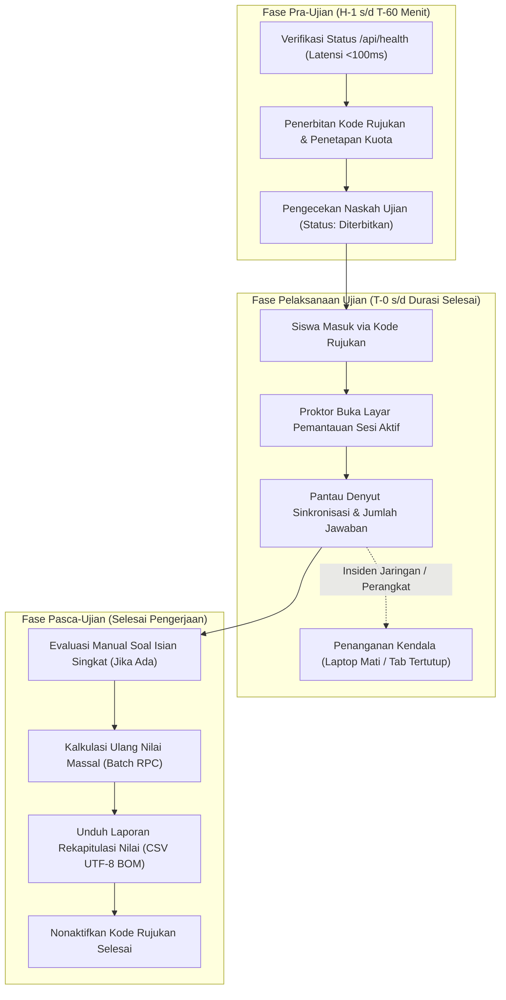

# Panduan Operasional Hari Ujian (*Exam Day Runbook*)
## Platform Ujian Teknis Terpadu (*OSN & General Technical Exam Web*)

Dokumen ini merupakan panduan praktis dan prosedur standar operasional (SOP) bagi panitia pelaksana, proktor ruang, teknisi laboratorium, dan guru pengawas pada saat menyelenggarakan ujian berbasis komputer menggunakan `osn-general-exam-web`.

---

## 1. Kronologi Operasional Pelaksanaan Ujian

---

## 2. Prosedur Pra-Ujian (Persiapan Panitia & Proktor)

### A. H-3 Hari Sebelum Ujian
1. **Pemeriksaan Basis Data Supabase:**
   * Kunjungi URL endpoint: `https://<domain-anda>/api/health`.
   * Pastikan respon HTTP 200 berstatus `"database": { "status": "connected" }`.
   * Jika muncul pesan database disconnected / paused, masuk ke [Supabase Dashboard](https://supabase.com/dashboard) dan klik tombol **"Restore project"**.
2. **Uji Coba Workflow Keep-Alive:**
   * Buka tab **Actions** di repositori GitHub $\to$ jalankan workflow **"Supabase Database Keep-Alive"** secara manual untuk memastikan pemicu cron berfungsi normal.

### B. H-1 Hari Sebelum Ujian
1. **Finalisasi Naskah Soal:**
   * Pastikan seluruh butir soal telah diperiksa kunci jawabannya.
   * Pastikan formula matematika KaTeX dan gambar diagram terender rapi.
   * Pastikan status naskah telah diubah menjadi **"Diterbitkan" (Published)**.
2. **Penerbitan Kode Rujukan Siswa:**
   * Masuk ke menu **Kode Rujukan** pada naskah ujian terkait.
   * Tentukan strategi pembagian kode:
     * *Opsi 1 (Satu Kode Kolektif):* Buat 1 kode rujukan untuk 1 ruangan (misal: kode `LAB1-OSN26`, kuota `max_uses` = 40).
     * *Opsi 2 (Kode Personal):* Buat kode unik berkuota `1` untuk masing-masing peserta terdaftar.
3. **Pengaturan Visibilitas Nilai:**
   * Pada tab *Edit Naskah*, tentukan opsi **Tampilkan Skor ke Peserta**:
     * Aktifkan jika siswa diperbolehkan langsung mengetahui skor setelah selesai.
     * Nonaktifkan jika nilai harus dirahasiakan untuk rapat dewan juri/guru.

### C. T-60 Menit (1 Jam Sebelum Siswa Memasuki Ruangan)
1. **Pemeriksaan Perangkat Laboratorium / Laptop:**
   * Pastikan peramban modern (Google Chrome, Microsoft Edge, atau Mozilla Firefox) telah terpasang dan diperbarui.
   * Pastikan koneksi Wi-Fi atau LAN lokal stabil.
2. **Persiapan Layar Pengawas:**
   * Proktor masuk ke portal admin di komputer pengawas: `https://<domain-anda>/admin/masuk`.
   * Buka halaman **Pemantauan Sesi Aktif**: `https://<domain-anda>/admin/ujian/[id]/pemantauan`.
   * Biarkan halaman ini tetap terbuka di layar utama pengawas.

---

## 3. Prosedur Selama Ujian Berlangsung

### A. Alur Masuk Peserta (T-0 Menit)
1. Instruksikan peserta membuka halaman utama: `https://<domain-anda>/`.
2. Peserta memasukkan kode rujukan yang dibagikan proktor di papan tulis.
3. Peserta memasukkan nama lengkap dan memilih kelas dari dropdown.
4. Pada kartu Lobi Pra-Ujian, minta peserta membaca instruksi durasi dan jumlah butir soal dengan saksama.
5. Saat bel mulai berbunyi, proktor menginstruksikan peserta menekan tombol **"Mulai Kerjakan Ujian"**.

### B. Pemantauan Real-Time oleh Pengawas
Pada halaman `/admin/ujian/[id]/pemantauan`:
1. **Periksa Jumlah Peserta Terdaftar:** Amati kartu metrik *Total Terdaftar* dan *Sesi Aktif*.
2. **Indikator Kolom Sinkronisasi Terakhir:**
   * Waktu sinkronisasi (misal: "Baru saja", "1 menit yang lalu") menandakan peramban siswa berhasil mengirimkan jawaban ke server.
   * Kolom *Jumlah Terjawab* (misal: `12 / 30`) menunjukkan progres pengisian soal oleh peserta secara real-time.
3. **Penggunaan Fitur Paginasi:** Gunakan selektor dropdown (25 / 50 / 100 baris) dan pencarian nama untuk menemukan siswa tertentu dengan cepat.

---

## 4. Penanganan Insiden & Kasus Khusus (*Incident Response*)

### Insiden 1: Laptop Siswa Mati Lampu, Baterai Habis, atau Layar Tertutup
* **Status Data:** Jawaban siswa **AMAT AMAN**. Seluruh progres telah tersimpan di memori lokal peramban dan tersinkronisasi ke server.
* **Tindakan:**
  1. Nyalakan kembali laptop siswa atau pindahkan siswa ke unit PC cadangan.
  2. Buka kembali peramban $\to$ akses `https://<domain-anda>/`.
  3. Sistem akan secara otomatis mendeteksi cookie sesi dan menampilkan kartu **"Lanjutkan Sesi Ujian"** beserta nama peserta.
  4. Siswa mengklik tombol lanjutkan dan akan langsung kembali ke ruang ujian dengan jawaban utuh serta sisa waktu yang tepat sesuai jam server.

### Insiden 2: Koneksi Internet Wi-Fi Terputus di Tengah Pengerjaan
* **Tindakan:**
  1. Minta siswa tetap tenang dan terus melanjutkan menjawab soal. Sistem *Dual-Tier Sync* akan tetap menyimpan jawaban di memori lokal peramban (*localStorage*).
  2. Begitu koneksi internet tersambung kembali, sistem secara otomatis mengirimkan akumulasi jawaban ke server tanpa perlu memuat ulang halaman (*auto-reconnect*).
  3. Pastikan indikator koneksi kembali hijau sebelum siswa menekan tombol "Selesaikan Ujian".

### Insiden 3: Siswa Melakukan Kecurangan / Pelanggaran Tata Tertib
* **Tindakan:**
  1. Pengawas membuka baris siswa yang bersangkutan pada tabel **Pemantauan Sesi Aktif**.
  2. Klik tombol merah **"Paksa Kumpulkan"** pada baris siswa tersebut.
  3. Konfirmasi modal dialog.
  4. Sesi ujian siswa akan langsung dikunci di basis data, dinilai secara instan, dan peramban siswa akan secara otomatis terblokir dari pengisian jawaban lebih lanjut.

### Insiden 4: Waktu Ujian Habis Namun Siswa Belum Menekan Tombol Selesai
* **Tindakan:**
  * Pengawas tidak perlu melakukan tindakan apapun. Komponen *Server-Authoritative Timer* akan secara otomatis mengunci seluruh input jawaban dan menyerahkan lembar jawaban siswa ke server secara mandiri begitu sisa waktu menyentuh angka `00:00:00`.

---

## 5. Prosedur Pasca-Ujian Selesai

### Langkah 1: Evaluasi Manual Butir Soal Isian Singkat (Jika Ada)
1. Buka menu **Evaluasi Manual** pada bilah samping ujian: `/admin/ujian/[id]/evaluasi`.
2. Pengawas/guru penilai membaca teks jawaban siswa yang disandingkan dengan rubrik referensi.
3. Masukkan skor perolehan siswa dan klik tombol **"Simpan Nilai"**.

### Langkah 2: Menghitung Ulang Nilai Massal (Jika Terjadi Revisi Kunci Jawaban)
Jika setelah ujian selesai terdapat butir soal pilihan ganda yang direvisi kunci jawabannya:
1. Buka menu **Bank Soal Ujian** $\to$ perbaiki pilihan kunci jawaban yang benar.
2. Buka menu **Laporan Rekapitulasi Nilai** (`/admin/ujian/[id]/laporan`).
3. Klik tombol **"Hitung Ulang Nilai"** di sudut kanan atas.
4. Mesin PostgreSQL Batch RPC akan mengevaluasi seluruh sesi peserta dan memperbarui total nilai dalam waktu kurang dari **150 milidetik**.

### Langkah 3: Mengunduh Laporan Resmi (Ekspor CSV)
1. Pada menu **Laporan Rekapitulasi Nilai**:
   * Klik tombol **"Ekspor Nilai (CSV)"** untuk mengunduh daftar peringkat, nama, kelas, waktu mulai, durasi pengerjaan, dan total skor.
   * Berkas CSV dienkode dalam format **UTF-8 BOM**, sehingga dapat langsung dibuka rapi di Microsoft Excel versi berapapun tanpa masalah karakter rusak atau kolom tergeser.
2. Klik tombol **"Ekspor Jawaban Lengkap (CSV)"** jika panitia memerlukan rincian matriks jawaban tiap butir soal per siswa untuk analisis butir soal (*item discrimination analysis*).

### Langkah 4: Penutupan Sesi & Keamanan
1. Buka menu **Kode Rujukan** $\to$ klik tombol toggle untuk **menonaktifkan** seluruh kode rujukan yang telah digunakan.
2. Hal ini memastikan tidak ada orang yang dapat memulai sesi ujian susulan tanpa seizin pengawas.
3. Pengawas mengklik tombol **"Keluar"** pada pojok kanan atas dasbor untuk mengakhiri sesi autentikasi admin.

---
*Runbook ini disusun untuk memastikan seluruh panitia memiliki pedoman terpadu yang jelas dalam menghadapi berbagai skenario di lapangan.*

